<div align="center">

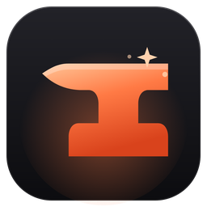

# Anvil

**Быстрая, лёгкая и красивая IDE на Rust.**<br>
Окно — за ~30 мс, память — около 90 МБ, а настраивается всё, вплоть до цвета каждой скобки.

[](https://github.com/mylifeitsbest/anvil/releases/latest)
[](https://github.com/mylifeitsbest/anvil/actions/workflows/ci.yml)


[](LICENSE)

### [⬇ Скачать для Windows (.exe)](https://github.com/mylifeitsbest/anvil/releases/latest)

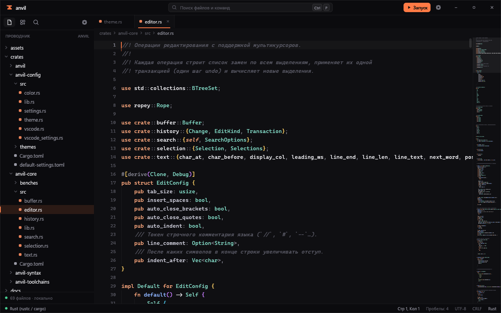

</div>

---

## Что внутри

- ⚡ **Мгновенно и легко.** Нативный бинарник на Rust, рендер на GPU (OpenGL, по желанию wgpu). Никакого Electron и браузера внутри. В простое не тратит ни одного кадра.
- 🎨 **Настраивается всё.** Шесть тем, свои темы в TOML, акцентный цвет, 32 цвета интерфейса и 23 класса подсветки по отдельности, скругления, плотность, шрифты, расположение панелей.
- ✨ **Анимации, которые можно выкрутить.** Каждая анимация — отдельный ключ: включить, выключить, задать длительность, стиль и кривую. Плавный курсор со шлейфом и свечением, мягкая прокрутка, искры при вводе (как Power Mode).
- 🔁 **Переезд из VS Code в один клик.** Перенос `settings.json`, импорт любой цветовой темы из установленных расширений, привычные сочетания клавиш (или пресеты JetBrains и Sublime).
- 🛠 **40+ компиляторов и интерпретаторов.** Anvil сам находит установленные тулчейны и запускает файл или проект по `F5`. Чего нет — ставится одной кнопкой (winget / brew / apt).
- ✍️ **Серьёзный редактор.** Мультикурсоры, Ctrl+D, перенос и дублирование строк, автоскобки, поиск и замена с regex, дерево undo/redo, миникарта, подсветка tree-sitter для 12 языков.
- 🧠 **Понимает код (LSP).** Автодополнение, описание символа при наведении, ошибки прямо в строке (как Error Lens), переход к определению, поиск ссылок, переименование по всему проекту, форматирование. 30 языковых серверов подключаются сами, недостающие ставятся одной кнопкой.

## Скачать

| Система | Файл | |
|---|---|---|
| **Windows 10/11 x64** | `anvil.exe` или `anvil-windows-x64.zip` | [Последний релиз](https://github.com/mylifeitsbest/anvil/releases/latest) |
| Linux x64 | `anvil-linux-x64.tar.gz` | [Последний релиз](https://github.com/mylifeitsbest/anvil/releases/latest) |
| macOS (Apple Silicon) | `anvil-macos-arm64.tar.gz` | [Последний релиз](https://github.com/mylifeitsbest/anvil/releases/latest) |

`anvil.exe` — один файл, установка не нужна. Пока он не подписан сертификатом, поэтому Windows SmartScreen может предупредить: «Подробнее» → «Выполнить в любом случае».

**Портативный режим:** создайте рядом с `anvil.exe` папку `anvil-data` — настройки, темы и паки будут храниться в ней (удобно для флешки).

```powershell
anvil.exe C:\projects\my-app             # открыть папку
anvil.exe main.rs                        # открыть файл
```

## Как это выглядит

<table>
<tr>
<td>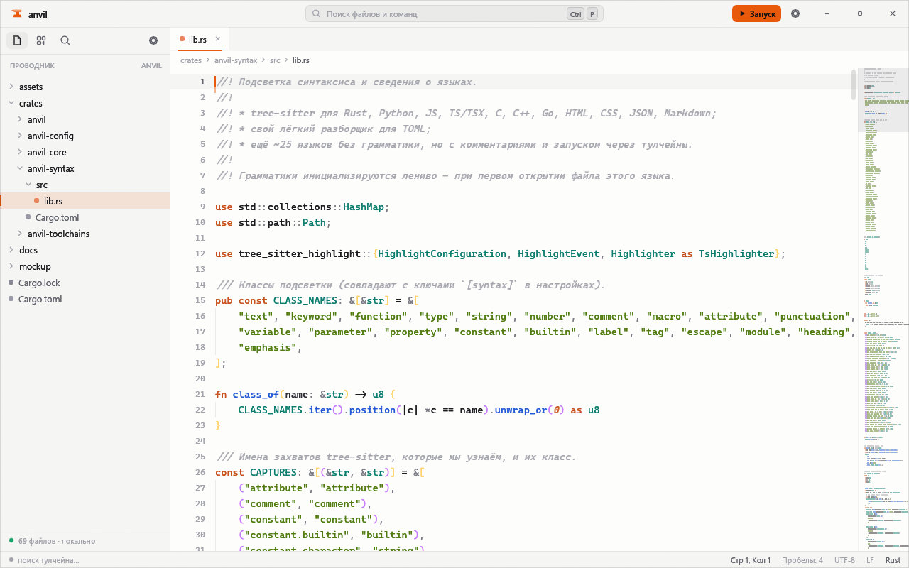<br><sub>Anvil Light</sub></td>
<td>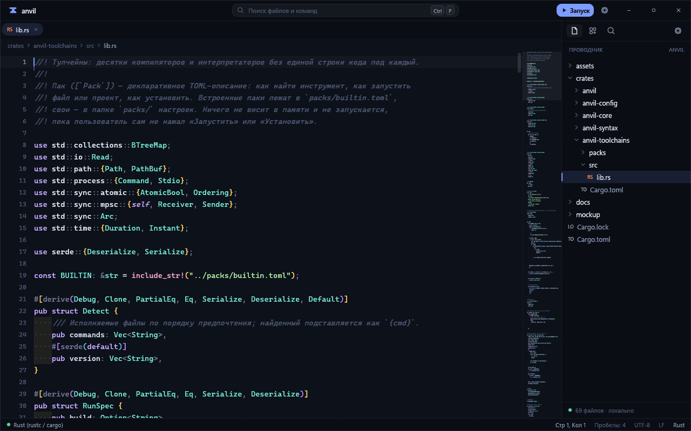<br><sub>Midnight: панель справа, радужные отступы, вкладки-«пилюли», видимые пробелы</sub></td>
</tr>
<tr>
<td>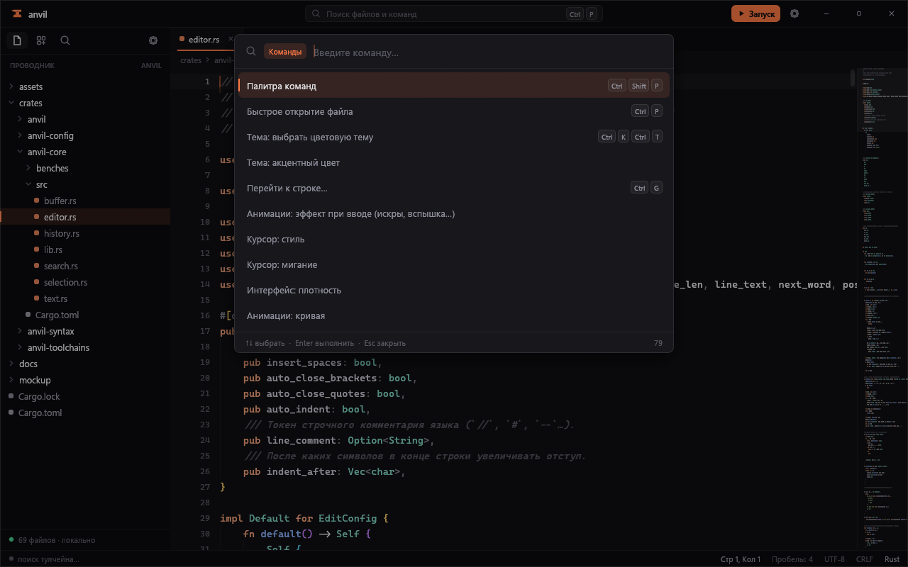<br><sub>Палитра команд с нечётким поиском</sub></td>
<td>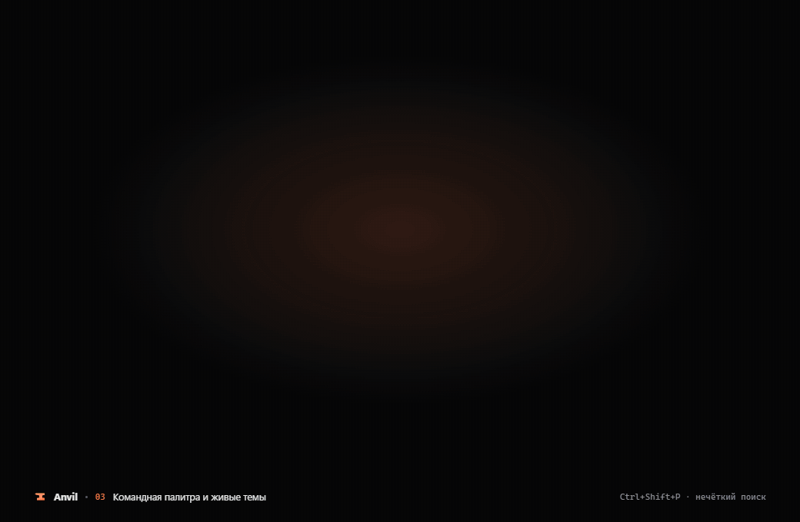<br><sub>Концепт: живой предпросмотр тем</sub></td>
</tr>
</table>

<details>
<summary><b>Концепт-анимации дизайна</b> (интерактивный макет лежит в <code>mockup/</code>)</summary>

| | |
|---|---|
| 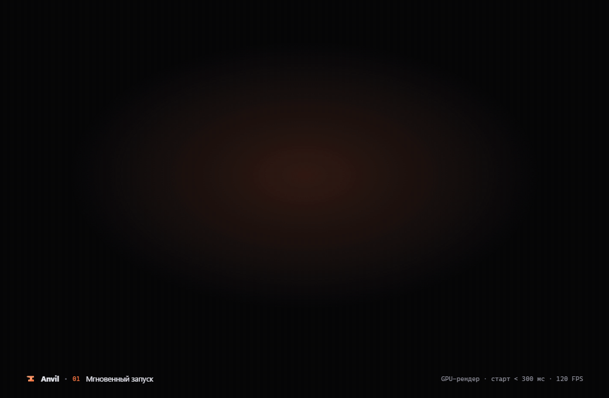 | 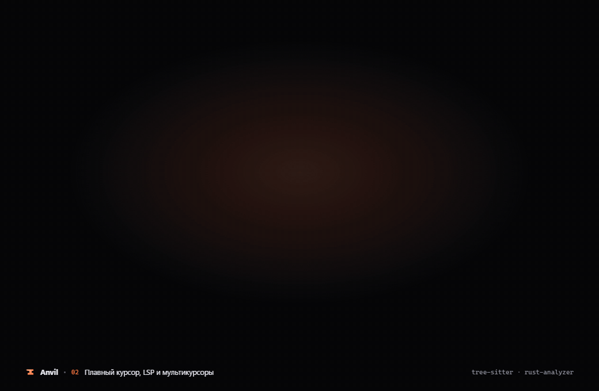 |
| 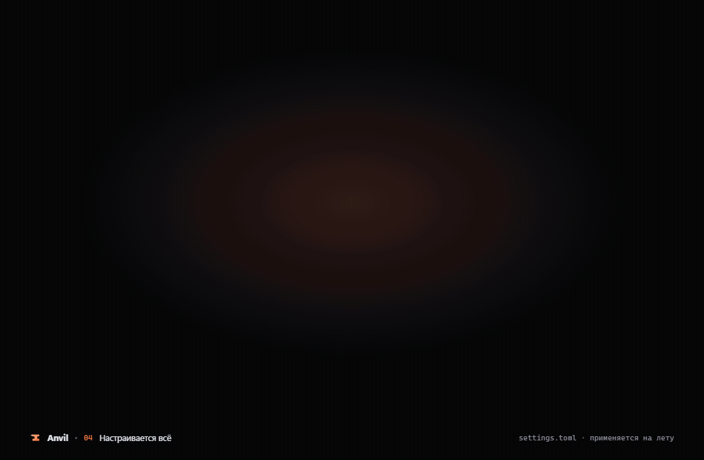 | 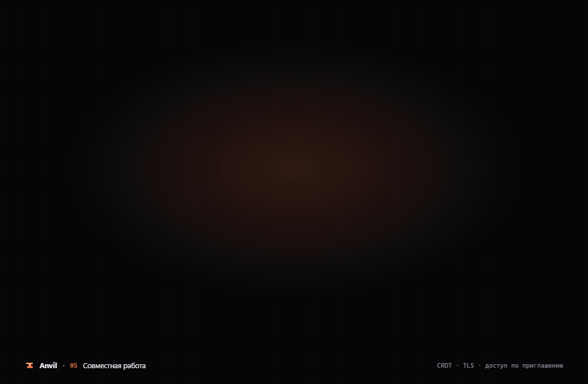 |

Это анимированный макет целевого дизайна. Часть показанного (совместная работа, LSP) — в планах, см. [дорожную карту](#дорожная-карта).
</details>

## Настраивается всё

Все настройки — один файл `settings.toml` (`Ctrl+,`). Изменения применяются **сразу после сохранения**, без перезапуска; смена темы при этом плавно перетекает. В файле по умолчанию каждый ключ подписан по-русски. Настройки проекта лежат в `.anvil/settings.toml` и перекрывают пользовательские.

```toml
[theme]
name = "midnight"          # anvil-dark · anvil-light · midnight · paper · graphite · oled · своя
accent = "#8b7bff"         # любой цвет; не задан — берётся из темы
radius = 12.0              # скругления интерфейса

[colors]                   # точечно перекрасить любой из 32 элементов интерфейса
sidebar = "#0b0d14"
selection = "#8b7bff40"

[syntax]                   # и любой из 23 классов подсветки
comment = { color = "#6a6a76", italic = true }
keyword = "#ff9e64"

[cursor]
style = "line"             # line · block · underline · hollow
blink = "smooth"           # smooth · blink · phase · expand · solid
smooth = true              # плавное движение
trail = true               # шлейф при прыжках
glow = true

[animations]
speed = 1.5                # всё вдвое… или в полтора раза быстрее
easing = "out-back"        # linear · out-cubic · out-quint · in-out-cubic · out-back · spring
palette = { enabled = true, duration_ms = 170, style = "scale" }
typing = { effect = "sparks", intensity = 1.2, shake = false }

[ui]
sidebar = "right"
density = "compact"
tab_style = "pill"
```

Любое значение можно поменять и без файла: палитра команд (`Ctrl+Shift+P`) → «Тема: выбрать», «Тема: акцентный цвет», «Курсор: стиль», «Анимации: эффект при вводе», «Анимации: кривая», «Вкладки: стиль» и т. д. Выбор сохраняется в `settings.toml`, комментарии в файле не теряются.

### Расширения VS Code, которые здесь уже встроены

Самые популярные «косметические» расширения VS Code в Anvil — это просто ключи настроек. Ничего не устанавливается и не грузится в память, пока выключено, и никакой сторонний код не исполняется.

| Расширение VS Code | В Anvil |
|---|---|
| Peacock | `theme.tint` (удобно задать в `.anvil/settings.toml` проекта) |
| indent-rainbow | `editor.rainbow_indent`, `editor.rainbow_indent_colors` |
| Bracket Pair Colorizer | `editor.bracket_colorization`, `editor.bracket_colors` |
| Better Comments / TODO Highlight | `editor.comment_tags`, `editor.comment_tag_colors` |
| Power Mode | `animations.typing` — искры, кольцо, вспышка, тряска |
| Smooth Caret / cursorSmoothCaretAnimation | `cursor.smooth`, `cursor.trail`, `cursor.glow` |
| VSCode Animations | `[animations]` — каждая анимация отдельно, скорость, кривая |
| GlassIt-VSC | `window.opacity` |
| Customize UI / Apc Customize UI++ | `[ui]` (размеры, плотность, панели) и `[colors]` |
| Темы (One Dark, Dracula, Catppuccin…) | импорт из установленных расширений или `themes/*.toml` |
| IntelliJ / Sublime Keybindings | `keymap.preset = "jetbrains"` / `"sublime"` |
| Error Lens | `lsp.inline_diagnostics` — текст ошибки в конце строки |
| Zen Mode / Center Editor | `ui.zen`, `editor.max_width` |
| Settings Sync | всё в одном `settings.toml` — его легко держать в git |

### Перенос из VS Code

- **Настройки:** палитра → «Перенос из VS Code: настройки (settings.json)». Шрифт, размер, межстрочный интервал, курсор, миникарта, пробелы, номера строк, автосохранение, масштаб и т. д. переносятся в `settings.toml`. Поддерживаются VS Code, Insiders, VSCodium, Cursor, Windsurf.
- **Темы:** «Перенос из VS Code: тема из установленных расширений» — список всех тем, что уже стоят у вас в VS Code; одна из них превращается в TOML-тему Anvil. Можно указать и любой `.json` вручную.

## Языковые серверы (LSP)

Anvil сам запускает языковой сервер, когда вы открываете файл, и останавливает его при выходе. В простое сервер не трогается, текст отправляется только после паузы в наборе.

<table>
<tr>
<td>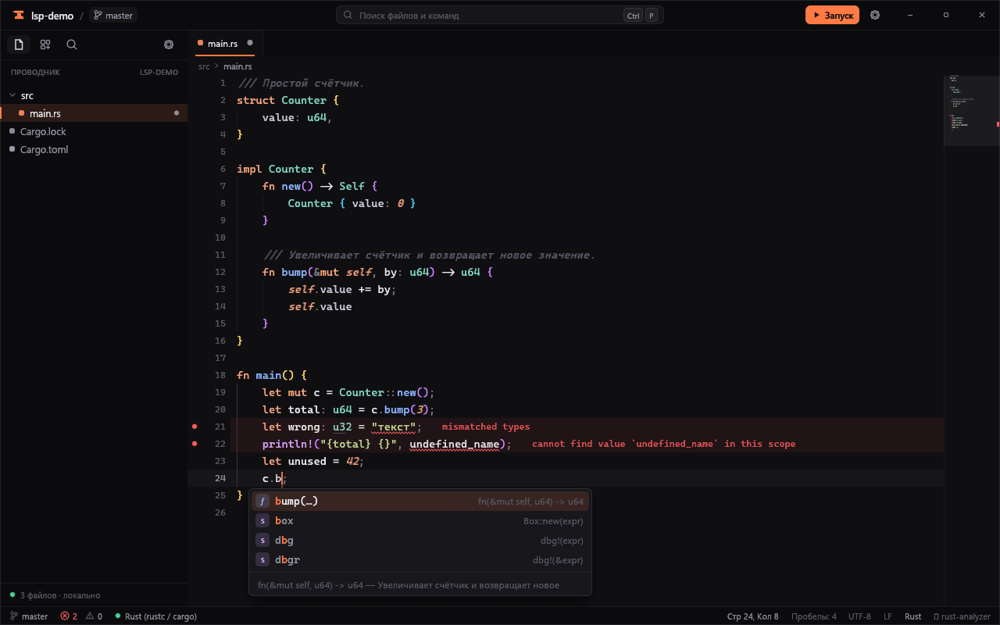<br><sub>Автодополнение с типами и описанием, сниппеты</sub></td>
<td>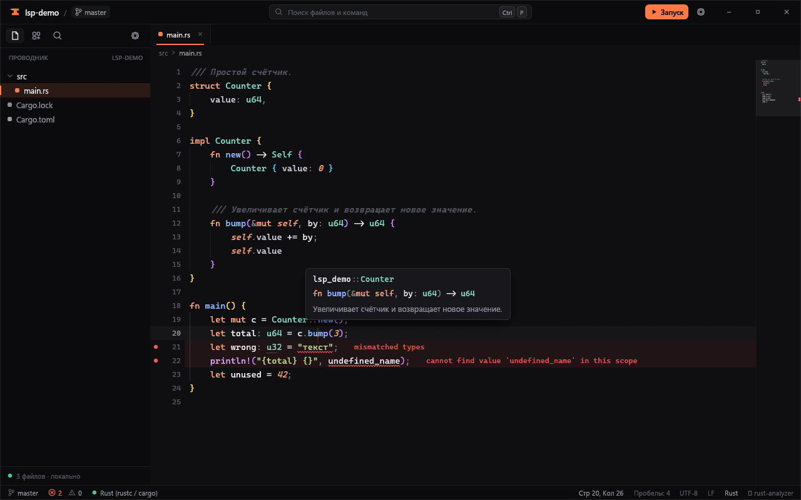<br><sub>Описание при наведении: сигнатура с подсветкой и документация</sub></td>
</tr>
<tr>
<td>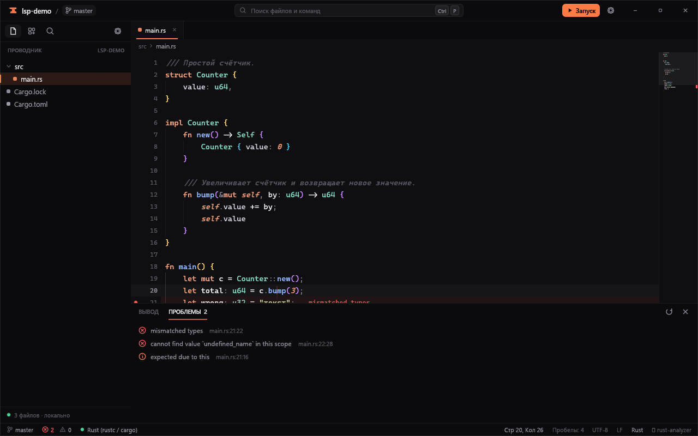<br><sub>Ошибки в строке (как Error Lens), метки на полях и миникарте, панель «Проблемы»</sub></td>
<td>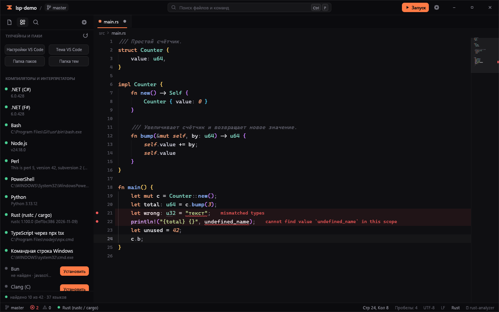<br><sub>Вкладка «Тулчейны»: компиляторы и языковые серверы с установкой в один клик</sub></td>
</tr>
</table>

- **Автодополнение** при вводе и по `Ctrl+Space`: нечёткий фильтр, типы, документация, сниппеты, автоимпорт.
- **Описание символа** при наведении мыши или по `Ctrl+K Ctrl+I`: сигнатура подсвечивается tree-sitter.
- **Ошибки и предупреждения**: волнистое подчёркивание, текст в конце строки, точки на полях и метки на миникарте, счётчик в строке состояния, панель «Проблемы» (`Ctrl+Shift+M`), переход `F8`.
- **Навигация и рефакторинг**: определение (`F12`, `Ctrl+клик`), все ссылки (`Shift+F12`), переименование во всём проекте (`F2`), форматирование (`Shift+Alt+F`, можно при сохранении).

**Встроенные серверы:** rust-analyzer · Pyright и pylsp · TypeScript/JavaScript · clangd (C/C++) · gopls · ZLS · Lua · Taplo (TOML) · Marksman (Markdown) · JSON / CSS / HTML · YAML · Bash · C# · F# · Java · Kotlin · Swift · Dart · Ruby · PHP · Haskell · OCaml · Nim · Scala · Fortran · R · CMake · Dockerfile.

Недостающий сервер ставится из вкладки «Тулчейны» той же проверенной командой (`rustup component add rust-analyzer`, `npm install -g pyright`, `winget install …`). Anvil отличает «не установлен» от «установлен не до конца»: например, прокси rustup без компонента rust-analyzer. Свой сервер — секция `[[server]]` в TOML-файле папки `packs/`.

```toml
[lsp]
completion_auto = true        # подсказки при вводе (false — только Ctrl+Space)
hover_delay_ms = 450
inline_diagnostics = "errors" # off · errors · all
format_on_save = true

[lsp.servers]
python = { command = "pylsp" }        # другой сервер для языка
rust = { enabled = false }            # выключить для языка
```

## 40+ компиляторов без плагинов

Anvil ищет установленные инструменты в `PATH` (без запуска процессов) и по `F5` собирает и запускает текущий файл. Если рядом есть файл проекта (`Cargo.toml`, `go.mod`, `package.json`, `*.csproj`, `CMakeLists.txt`, `build.zig`…), запускается проект. Вывод — в нижней панели.

**Из коробки:** Rust · C и C++ (GCC, Clang, MSVC, Zig) · Go · Python · JavaScript (Node, Bun, Deno) · TypeScript (Bun, Deno, tsx) · Java · Kotlin · C# · F# · Swift · Dart · Scala · D · Nim · Crystal · Zig · Ruby · PHP · Perl · Lua · Haskell · OCaml · Elixir · Erlang · Julia · R · Fortran · Pascal · Bash · PowerShell · Batch · Make · CMake · NASM.

Не установлено? Вкладка «Тулчейны» (`Ctrl+Shift+X`) показывает, что найдено, а что нет. Кнопка «Установить» выполняет проверенную команду: на Windows — `winget`, на macOS — `brew`, на Linux — `apt` или официальный установщик. Перед запуском команда показывается и требует подтверждения.

**Свой язык — один TOML-файл** в папке `packs/`:

```toml
[[pack]]
id = "brainfuck"
name = "Brainfuck"
languages = ["brainfuck"]
detect = { commands = ["bf"] }
run = { run = "bf {file}" }
install = { windows = "scoop install bf" }
```

Команды можно переопределить и в настройках: `[toolchains.overrides] rust = { run = "cargo run --release" }`.

## Горячие клавиши

Как в VS Code. Пресеты JetBrains и Sublime и любые свои сочетания (включая аккорды вроде `ctrl+k ctrl+o`) задаются в `[keymap]`.

| | |
|---|---|
| `Ctrl+Shift+P` / `F1` | палитра команд |
| `Ctrl+P` | быстрое открытие файла (`>` — команды, `:` — строка) |
| `Ctrl+D` / `Ctrl+Shift+L` | следующее / все вхождения (мультикурсор) |
| `Alt+клик`, `Ctrl+Alt+↑↓` | добавить курсор |
| `Alt+↑↓`, `Shift+Alt+↑↓` | переместить / дублировать строки |
| `Ctrl+/` | закомментировать |
| `Ctrl+F` / `Ctrl+H` | поиск / замена (регистр, слово, regex) |
| `F5` / `Shift+F5` | запустить / остановить |
| `Ctrl+Space` | подсказки (дополнение) |
| `F12` / `Ctrl+клик` | перейти к определению |
| `Shift+F12` | все ссылки |
| `F2` | переименовать символ во всём проекте |
| `Shift+Alt+F` | отформатировать документ |
| `Ctrl+K Ctrl+I` | описание символа под курсором |
| `F8` / `Shift+F8` | следующая / предыдущая проблема |
| `Ctrl+Shift+M` | панель проблем |
| `Ctrl+B` / `Ctrl+J` | боковая панель / панель вывода |
| `Ctrl+K Z` | режим «дзен» |
| `Ctrl+,` | настройки |

## Сборка из исходников

```bash
git clone https://github.com/mylifeitsbest/anvil
cd anvil
cargo run --release                  # OpenGL
cargo run --release --features wgpu  # рендер через wgpu (DX12 / Vulkan / Metal)
```

Нужен Rust 1.88+. На Windows — MSVC Build Tools, на Linux — `libxkbcommon-dev libgl1-mesa-dev libx11-dev libxcursor-dev libxrandr-dev libxi-dev libwayland-dev`.

```bash
cargo test --workspace                                   # тесты
cargo clippy --workspace --all-targets -- -D warnings    # без предупреждений
cargo bench -p anvil-core                                # бенчмарки ядра
cargo deny check                                         # уязвимости и лицензии
```

Для проверок интерфейса без рук есть сценарии: `anvil.exe ПАПКА ФАЙЛ --script сценарий.txt`. Строки сценария — `at КАДР goto|type|run|input|enter|esc|shot|quit …`; окно при этом рисуется за пределами экрана. Журнал обмена с языковыми серверами — переменная `ANVIL_LSP_LOG=путь`.

```bash
# пример сценария
at 1500 goto 20 26
at 1510 run lsp.hover
at 1800 shot hover.bmp
at 1810 quit
```

## Архитектура

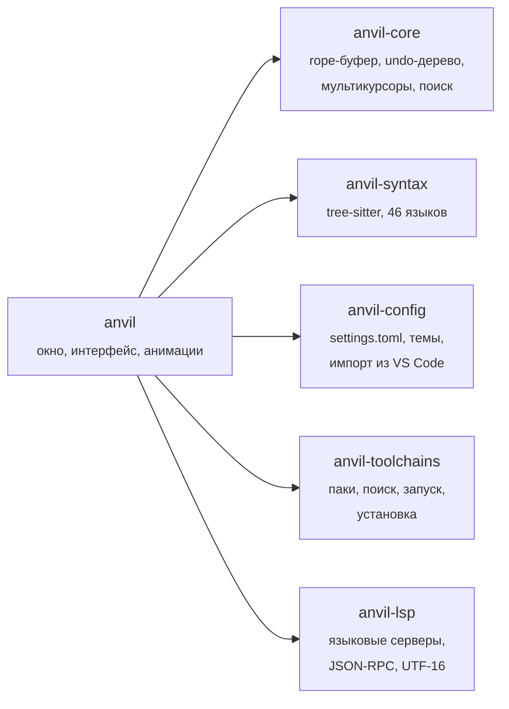

| Крейт | Что делает |
|---|---|
| `anvil-core` | Без интерфейса и полностью покрыт тестами: буфер на `ropey`, нормализация переводов строк, дерево undo/redo (ветки не теряются, ввод склеивается), выделения и все операции редактирования, поиск и замена с regex |
| `anvil-syntax` | Подсветка tree-sitter (Rust, Python, JS, TS/TSX, C, C++, Go, HTML, CSS, JSON, Markdown) с ленивой загрузкой грамматик, свой разбор TOML, пары скобок для раскраски |
| `anvil-config` | Схема настроек со значениями по умолчанию, слияние пользовательских и проектных настроек, неизвестные ключи — предупреждением, а не ошибкой; темы; импорт тем и настроек VS Code |
| `anvil-toolchains` | Декларативные паки, поиск в `PATH`, план запуска (файл или проект), потоковый вывод процессов, установка |
| `anvil-lsp` | Клиент LSP: реестр 30 серверов (TOML), процесс сервера и JSON-RPC поверх stdio в фоновом потоке, позиции UTF-8/16/32, сниппеты, разбор hover-markdown. Без tokio — один поток на сервер |
| `anvil` | Интерфейс на [egui](https://github.com/emilk/egui): всё нарисовано вручную через `Painter`, свой заголовок окна, твины для анимаций |

**Почему egui, а не gpui или Electron.** egui — зрелый GPU-рендер с немедленным режимом, который собирается под Windows, Linux и macOS одной командой и даёт полный контроль над каждым пикселем. Окно появляется за десятки миллисекунд, а в покое кадры не рисуются вообще. gpui (фреймворк Zed) быстрее на огромных файлах, но его API ещё нестабилен и тянет за собой много платформенного кода. Ядро (`anvil-core`) от интерфейса не зависит, так что фронтенд можно заменить, не трогая логику редактора.

## Производительность

Замеры на Windows 11 (релизная сборка, открыт проект и файл):

| | Anvil 0.1 |
|---|---|
| Окно появилось | 32–115 мс |
| Память (рабочий набор) | ~90 МБ |
| Размер `anvil.exe` | 17,7 МБ, один файл |
| Нагрузка в простое | 0 кадров/с (курсор перестаёт мигать после `cursor.blink_timeout_s`) |

Бенчмарки ядра (`cargo bench -p anvil-core`, criterion):

| Операция | Время |
|---|---|
| Загрузка текста 100 МБ в буфер | 83 мс |
| Вставка символа в файл 100 МБ (с записью в историю) | 2,1 мкс |
| Два `Ctrl+D` по файлу 1 МБ | 1,6 мс |

## Дорожная карта

- [x] Окно со своим заголовком, проводник, вкладки, хлебные крошки, строка состояния
- [x] Редактор: мультикурсоры, автоскобки, автоотступы, перенос и дублирование строк, комментарии
- [x] Дерево undo/redo, поиск и замена (regex), миникарта, подсветка парных скобок
- [x] Подсветка tree-sitter для 12 языков
- [x] Палитра команд и быстрое открытие файлов с нечётким поиском
- [x] Темы, тонкая настройка цветов, горячая перезагрузка настроек
- [x] Настраиваемые анимации, эффекты ввода, плавный курсор
- [x] 40+ тулчейнов: поиск, запуск, установка
- [x] Перенос настроек и тем из VS Code
- [x] LSP: автодополнение, описание при наведении, переход к определению, ссылки, переименование, форматирование, диагностика и панель проблем
- [ ] LSP: подсказки параметров, code actions, inlay hints, семантическая подсветка
- [ ] Встроенный терминал (`alacritty_terminal`)
- [ ] Панель Git (`gix`): статус, diff в редакторе, коммит, ветки
- [ ] Разделение редактора, сворачивание блоков, перенос строк
- [ ] Отдельный backend-процесс и протокол frontend ↔ backend
- [ ] Удалённая разработка по SSH
- [ ] Совместная работа в реальном времени (CRDT, relay-сервер, TLS, доступ по приглашению)
- [ ] Расширения в песочнице WebAssembly (`wasmtime`) с явными разрешениями
- [ ] «Доверие к папке» перед запуском задач из незнакомых проектов

## Безопасность

- `unsafe_code = "forbid"` во всех крейтах; `unwrap`/`expect` запрещены линтами.
- Паки и темы — это данные (TOML), а не код: их загрузка ничего не исполняет.
- Процессы запускаются только по явному действию пользователя («Запустить», «Установить» с подтверждением).
- В CI работают `cargo clippy -D warnings`, тесты на трёх ОС и `cargo deny` (уязвимости, лицензии, источники).

## Лицензия

[MIT](LICENSE).
